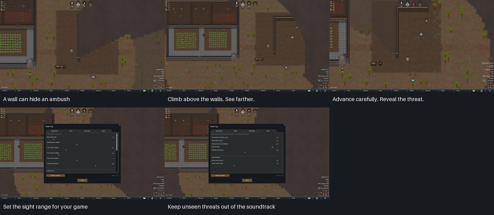

# Total Fog screenshots and short film

These files are the reusable media for Total Fog's Workshop page. The filenames
stay the same when the media is refreshed. Use a `main` link for the latest
version, or replace `main` with a commit SHA to keep a particular version.

[View all five screenshots](contact-sheet.png) ·
[Download the 18-second video](total-fog-showcase.mp4) ·
[Steam Workshop](https://steamcommunity.com/sharedfiles/filedetails/?id=3820003593)



| View | Original capture | Workshop copy |
| --- | --- | --- |
| A wall corner hiding an ambush | [PNG](01-exploration.png) | [JPEG](01-exploration.jpg) |
| A lookout revealing threats beyond the walls | [PNG](02-watchtower.png) | [JPEG](02-watchtower.jpg) |
| Advancing around the corner into a firefight | [PNG](03-colony.png) | [JPEG](03-colony.jpg) |
| Vision settings | [PNG](04-vision.png) | [JPEG](04-vision.jpg) |
| Audio settings | [PNG](05-audio.png) | [JPEG](05-audio.jpg) |

For embedding an image elsewhere, use a raw URL, for example:

```
https://raw.githubusercontent.com/pardeike/TotalFog/main/Media/Showcase/02-watchtower.jpg
```

The video URL is:

```
https://github.com/pardeike/TotalFog/raw/refs/heads/main/Media/Showcase/total-fog-showcase.mp4
```

## Reproduce the media

Run from the repository root on the configured macOS development machine, with
Steam signed in and RimWorld stopped:

```sh
./scripts/mod showcase
```

This loads the checked-in fictional colony, records the five views in
[recipe.json](recipe.json), encodes the video and verifies the finished files.
It uses a separate GABS profile, `total-fog-showcase`, and savedata under
`artifacts/ShowcaseUserData`. It does not load or overwrite a player's save or
preferences. The command builds and installs only the non-shipping companion;
the installed gameplay DLL must already match the tracked release. It stops
its own game when finished.

| Command | Purpose |
| --- | --- |
| `./scripts/mod showcase` | Replace the complete finished bundle after successful capture and encoding |
| `./scripts/mod showcase stills` | Preview the five views in `artifacts/showcase/output`, leaving this bundle intact |
| `./scripts/mod showcase verify` | Check the finished files against their manifest without launching a game |
| `./scripts/mod showcase publish` | Upload these five JPEGs and the optional YouTube preview to the owner's Workshop gallery; verify the native readback |
| `./scripts/mod showcase stage` | Deliberately regenerate the fictional reference colony; normally keep the existing save |

The publishing command updates images with matching filenames and appends any
missing images. It preserves unrelated gallery entries, the primary preview and
the mod's content and metadata. It writes `workshop-gallery.json` here after a
successful upload and readback. Steam's video preview API takes a YouTube ID;
this workflow produces a local MP4 and does not upload it to a video service.
After an approved unlisted YouTube upload, keep `youtube.json` in this folder
with its `videoId`, `url`, `title`, `visibility: "unlisted"` and `sourceSha256`
matching the MP4. The next `publish` adds that video to Steam, or replaces our
previous video preview in place. It preserves other videos. A new capture
requires a new YouTube upload and updated receipt before publication.

Prerequisites are the repository's pinned .NET SDK, Python 3.11 or newer,
`uv`, FFmpeg with libx264, Steam RimWorld, released Workshop Harmony,
RimBridgeServer 2.x and the configured local GABS MCP. Pillow 12.3.0 is resolved
through `uv` into the ignored project cache. No DLC or other gameplay mod is
used. The wrapper uses Steam's logical `RimWorld/Mods` path, including when that
directory is a symlink. An existing unrelated GABS profile is preserved.

## Capture conditions

- The actual game viewport is **1920×1080, windowed**, with **UI scale 1.0**.
  The companion verifies the resolution, fullscreen state and logical UI size
  before every screenshot. It never resizes a native capture afterward.
- The recipe pins camera positions, zooms, an 18-cell sight preset, remembered
  fog opacity 120 and English
  settings pages. The sight preset is chosen for these scenes; it is not the
  mod's default sight range.
- [reference.rws.gz](reference.rws.gz) holds the fictional colony, terrain,
  weather, local summer noon and native fog memory. Every shot reloads it.
  The staging seed is 150026. Initial remembered land came
  from actual colonist observations during setup.
- Moving sections advance two native simulation ticks per captured frame.
  At 30 fps this gives normal simulation speed, independent of capture time.
  After each step the capture tool refreshes the native pawn draw interpolator,
  which otherwise retains an old position while paused. This follows the
  current native path position and leaves the gameplay and tower drawing intact.
  The settings pages hold still for 2.5 seconds each. Plant wind sway, tutorial
  overlays and debug counters are disabled for photography.
- The video is **18 seconds**, **540 frames**, H.264/yuv420p, with no audio.
  It shows a corner ambush, the watchtower revealing its surroundings, a
  firefight after advancing and two settings
  pages. Titles are added during encoding; the game rendering stays native.
- PNGs are lossless masters. JPEGs are the same 1920×1080 images encoded below
  Steam's 1 MB gallery limit. The contact sheet is a labelled review board.

[manifest.json](manifest.json) records actual engine and mod versions, loaded
mods, viewport, gameplay and companion hashes, tick assertions and file hashes.
It also records the visible and hidden raiders and the colonists' logical and
drawn positions at each chosen still frame. The enemies, walls, cover, weapon
jobs and line-of-sight changes are native game objects and behavior.
It describes the captures, not general gameplay or performance acceptance.
The reference save and fixed ticks make conditions comparable; engine, GPU and
shader differences can still change pixels. Do not promise identical bytes
across machines or game updates.

Keep finished media, recipe, reference and manifest in this folder. Native frame
sequences, logs and encoding intermediates belong in ignored
`artifacts/showcase/`. Commit and push the complete refreshed bundle together.
