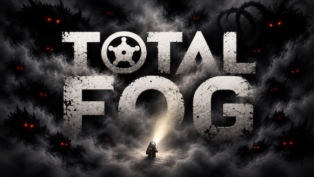

# Total Fog

**You only know what your colonists can see.**

Total Fog brings real fog of war to RimWorld. The map stays dark until someone
looks at it. When your colonists walk away, the area turns grey and you no
longer know what happens there. A raid can come out of the dark, and a noise at
night might be a boar, or something much worse. To stay safe, you have to look.

Total Fog runs on RimWorld 1.6 and 1.7. Questions, ideas and bug reports are
welcome on the [Brrainz Discord](https://discord.gg/G4r84eN7w6) or as
[GitHub issues](https://github.com/pardeike/TotalFog/issues).

[In-game screenshots and an 18-second video](Media/Showcase/README.md).

## What it does

### Sight

- Colonists, colony mechs, trained animals and turrets each see a circle around
  them. Walls block the view, and trees can too if you like.
- A new colony starts unexplored. Places you have seen stay on the map in grey:
  you know the ground, but not who is there right now.
- Your own colonists, animals and blueprints stay under your control everywhere.
  Buildings you have seen can still be selected and given work orders where you
  last saw them.
- Allies, visitors and prisoners can share what they see, if you allow it.

### Cameras, telescope and watchtower

- Surveillance cameras go on posts, on walls, under roofs or hidden in bushes,
  and some run on solar power. A colonist at a camera console watches the
  feeds, or you let the cameras work on their own.
- A watch telescope doubles the sight range of whoever stands on it.
- The 3x3 watchtower holds one lookout who sees over walls. Send someone up for
  a 1, 2 or 4 hour watch, or keep a drafted lookout there as long as you need.
  Lookouts can also shoot from the tower if you allow it.
- Keep the ladder clear. A lookout who cannot climb down has to wait, or jump
  in an emergency.
- The tower needs Complex furniture research. Better cameras and the telescope
  need their own research.

### Sound

- Combat and Anomaly music are off by default, so the soundtrack does not warn
  you about threats you cannot see.
- Sounds from hidden things can be muted, or muffled based on what your
  colonists can hear.
- Small sound markers can hint that something is moving out there.

### News

- Letters and messages about things nobody has seen can wait until someone sees
  them, or be skipped by type: big threats, small threats, good news, bad news.
- Colony health and global events always arrive straight away.
- New Anomaly entities enter the journal when someone first sees them.
- Optional **Silent raids**: no arrival letter and no slowdown when raids or
  manhunter packs arrive.

### Fair enemies

- Optional: humanlike enemies can only target what their own faction can see.
  Your hidden sniper stays hidden.

### Your rules

Four settings pages (Appearance, Vision, Information and Audio) let you choose
how dark the fog is, how fast it fades, how far everyone sees and what may give
away hidden activity. Play it as a hard survival challenge or as a light change
of atmosphere.

Out of the box, the fog is on and combat music is off. Delayed messages, sound
checks, Silent raids and hiding unseen wildlife are there when you want a
stricter game.

## Good to know

- **Requires** [Harmony](https://steamcommunity.com/sharedfiles/filedetails/?id=2009463077)
  and RimWorld 1.6 or 1.7.
- **Languages:** English, German, French, Spanish, Latin American Spanish, Dutch,
  Swedish, Polish, Russian, Turkish, Japanese, Korean, Simplified Chinese and
  Traditional Chinese.
- **Replaces** Real Fog of War and NWN Real Fog of War, so turn those off.
  Switching keeps your explored map and waiting messages. Back up your save
  first.
- **Fast:** a new sight engine built for big colonies and long mod lists.
- **Zombieland:** with an up-to-date Zombieland, zombie effects, warnings and
  the Symbiant stay hidden in the fog.
- **Combat Extended:** its targeting respects the fog too.

## For mod developers

Does your mod draw effects, play sounds or show counters? Then it can give away
what hides in the fog. A small optional file lets your mod respect the fog
without depending on Total Fog: see the [integration guide](docs/INTEGRATION.md).
[Zombieland](https://github.com/pardeike/Zombieland) uses it.

To build Total Fog yourself, see [docs/DEVELOPMENT.md](docs/DEVELOPMENT.md).

## Credits and license

Total Fog is an independent continuation of **Real Fog of War** by Luca De Petrillo
and the **NWN Real Fog of War** continuation maintained by Mlie. Thank you both.
Maintained by Andreas Pardeike. Apache License 2.0: see [LICENSE.md](LICENSE.md)
and [NOTICE.md](NOTICE.md).
